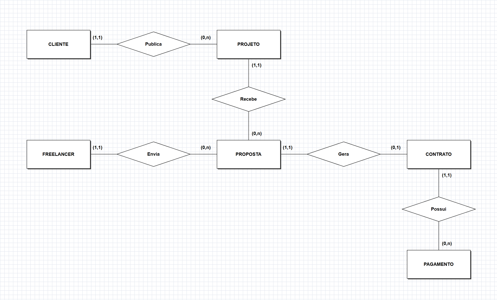
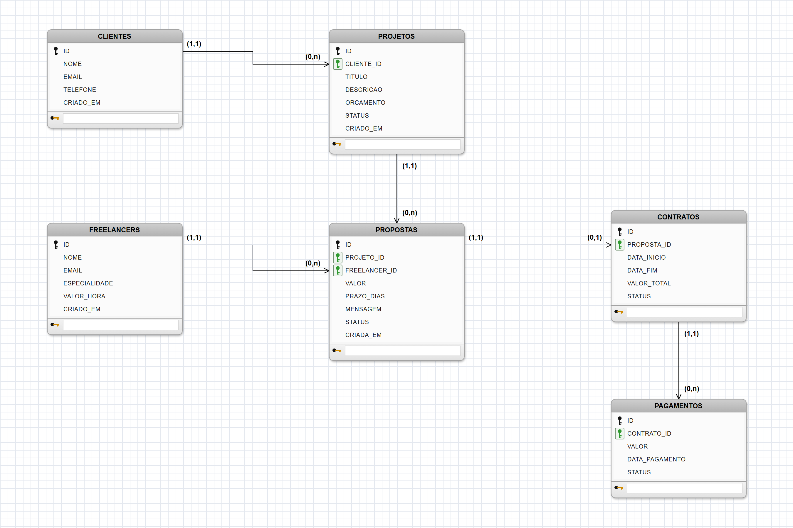

# Trabalho Final - Banco de Dados

## 1. Descricao do sistema

**Nome do sistema:** Freela Facil

**Area de atuacao:** plataforma de freelancers.

**Objetivo do sistema:** cadastrar clientes, freelancers, projetos, propostas, contratos e pagamentos.

**Problema que resolve:** ajuda a organizar a contratacao de freelancers, permitindo que clientes publiquem projetos e recebam propostas de profissionais.

## 2. Banco de dados

### 2.1 Modelo de dados

O modelo possui 6 entidades:

- `clientes`
- `freelancers`
- `projetos`
- `propostas`
- `contratos`
- `pagamentos`

### Modelo conceitual (MER - notacao Chen)



Entidades em retangulos, relacionamentos em losangos e cardinalidades (minima, maxima) junto a cada entidade.

### Modelo logico relacional



Tabelas com atributos, chave primaria (chave preta) e chaves estrangeiras (chave verde). As setas saem da PK e apontam para a tabela que guarda a FK.

### Entidades

| Entidade | O que representa |
|----------|------------------|
| `clientes` | Pessoas ou empresas que publicam projetos |
| `freelancers` | Profissionais que enviam propostas |
| `projetos` | Demandas publicadas por um cliente |
| `propostas` | Oferta de um freelancer para um projeto (entidade associativa) |
| `contratos` | Acordo gerado quando uma proposta e aceita |
| `pagamentos` | Valores pagos dentro de um contrato |

### Relacionamentos e cardinalidades

| Relacionamento | Cardinalidade | Explicacao |
|----------------|---------------|------------|
| CLIENTE publica PROJETO | (1,1) : (0,n) | Um cliente publica nenhum ou varios projetos; cada projeto pertence a exatamente um cliente. |
| PROJETO recebe PROPOSTA | (1,1) : (0,n) | Um projeto recebe nenhuma ou varias propostas; cada proposta e para exatamente um projeto. |
| FREELANCER envia PROPOSTA | (1,1) : (0,n) | Um freelancer envia nenhuma ou varias propostas; cada proposta e de exatamente um freelancer. |
| PROPOSTA gera CONTRATO | (1,1) : (0,1) | So a proposta aceita gera contrato, e no maximo um; cada contrato vem de exatamente uma proposta. |
| CONTRATO possui PAGAMENTO | (1,1) : (0,n) | Um contrato pode ser pago em varias parcelas; cada pagamento pertence a um contrato. |

### Mapeamento conceitual-logico e resolucao do N:N

Entre FREELANCER e PROJETO existe um relacionamento **N:N**: um freelancer pode enviar propostas para varios projetos e um projeto pode receber propostas de varios freelancers. No modelo relacional isso nao pode ser representado com uma FK simples, entao foi resolvido pela **entidade associativa `propostas`**, que vira uma tabela com:

- `projeto_id` (FK → `projetos.id`)
- `freelancer_id` (FK → `freelancers.id`)
- atributos proprios do relacionamento: `valor`, `prazo_dias`, `mensagem`, `status`

Assim, o N:N vira dois relacionamentos 1:N (PROJETO 1:N PROPOSTA e FREELANCER 1:N PROPOSTA). A proposta tem `id` proprio porque tambem participa de outro relacionamento (gera contrato).

Demais regras de mapeamento usadas:

| Conceitual | Logico |
|------------|--------|
| Cada entidade | Uma tabela com `id SERIAL PRIMARY KEY` |
| Relacionamento 1:N | FK `NOT NULL` na tabela do lado N (`projetos.cliente_id`, `propostas.projeto_id`, `propostas.freelancer_id`, `pagamentos.contrato_id`) |
| Relacionamento 1:1 opcional | FK com `UNIQUE` (`contratos.proposta_id`) |
| Atributos com dominio fixo | Constraints `CHECK` (status, valores > 0) |

## 2.2 Script DDL

O script DDL esta em `database/01_ddl.sql`.

Ele possui:

- `CREATE TABLE`
- chaves primarias
- chaves estrangeiras
- constraints
- view
- procedure
- function
- trigger para validar pagamentos

## 2.3 Script DML

O script DML esta em `database/02_dml.sql`.

Ele possui:

- `INSERT`
- `UPDATE`
- `DELETE`
- `SELECT`
- consultas com `JOIN` (3 consultas de listagem e 3 relatorios)
- `GROUP BY` com `COUNT`, `SUM` e `AVG`
- `HAVING` para filtrar grupos
- `ORDER BY` crescente e decrescente

### Consultas com GROUP BY, HAVING e ORDER BY

Regra usada: o `WHERE` filtra as **linhas antes** do agrupamento e o `HAVING` filtra os **grupos depois** do `GROUP BY`.

**Consulta 1 (consulta integrada) - freelancers mais ativos**

Necessidade do sistema: saber quais profissionais mais participam da plataforma e qual o valor medio que cobram.

```sql
SELECT f.nome AS freelancer, f.especialidade,
       COUNT(pr.id) AS total_propostas,
       ROUND(AVG(pr.valor), 2) AS valor_medio
FROM freelancers f
JOIN propostas pr ON pr.freelancer_id = f.id
GROUP BY f.id, f.nome, f.especialidade
HAVING COUNT(pr.id) >= 2
ORDER BY total_propostas DESC, valor_medio DESC;
```

- `JOIN` liga cada freelancer as suas propostas.
- `GROUP BY` forma um grupo por freelancer; `COUNT` e `AVG` calculam quantidade e valor medio.
- `HAVING` mantem so quem enviou pelo menos 2 propostas (Beatriz, com 1 proposta, sai do resultado).
- `ORDER BY` coloca os mais ativos primeiro e desempata pelo valor medio.

**Consulta 2 - clientes que mais investem**

Necessidade: identificar os clientes com maior volume contratado.

```sql
SELECT c.nome AS cliente, COUNT(co.id) AS total_contratos,
       SUM(co.valor_total) AS total_contratado
FROM clientes c
JOIN projetos p ON p.cliente_id = c.id
JOIN propostas pr ON pr.projeto_id = p.id
JOIN contratos co ON co.proposta_id = pr.id
WHERE co.status <> 'CANCELADO'
GROUP BY c.id, c.nome
HAVING SUM(co.valor_total) >= 6000
ORDER BY total_contratado DESC;
```

Aqui aparecem os dois filtros: o `WHERE` remove contratos cancelados antes de agrupar e o `HAVING` remove clientes com total contratado abaixo de R$ 6.000.

**Consulta 3 - contratos com saldo a pagar**

Necessidade: acompanhar quais contratos ainda tem valores pendentes.

```sql
SELECT co.id AS contrato_id, p.titulo AS projeto, f.nome AS freelancer,
       co.valor_total,
       COALESCE(SUM(pg.valor), 0) AS total_pago,
       co.valor_total - COALESCE(SUM(pg.valor), 0) AS saldo
FROM contratos co
JOIN propostas pr ON pr.id = co.proposta_id
JOIN projetos p ON p.id = pr.projeto_id
JOIN freelancers f ON f.id = pr.freelancer_id
LEFT JOIN pagamentos pg ON pg.contrato_id = co.id AND pg.status = 'PAGO'
GROUP BY co.id, p.titulo, f.nome, co.valor_total
HAVING COALESCE(SUM(pg.valor), 0) < co.valor_total
ORDER BY saldo DESC;
```

O `LEFT JOIN` mantem contratos ainda sem pagamento, o `HAVING` exclui os contratos quitados e o `ORDER BY` mostra primeiro o maior saldo.

## 3. Sistema em Java com JDBC

O sistema usa JDBC para conectar no PostgreSQL.

A classe `Conexao.java` centraliza a conexao com o banco.

As classes DAO executam os comandos SQL:

- `ClienteDAO.java`
- `ProjetoDAO.java`
- `PropostaDAO.java`
- `PagamentoDAO.java`

A classe `Main.java` possui um menu simples no terminal.

## 3.2 CRUD completo

O CRUD foi implementado principalmente para clientes e projetos.

Clientes:

- cadastrar cliente
- listar clientes
- atualizar email do cliente
- excluir cliente

Projetos:

- cadastrar projeto
- listar projetos com cliente
- atualizar status do projeto
- excluir projeto

Tambem existem cadastros e consultas para propostas e pagamentos.

Consultas com JOIN, agrupamento, filtro e ordenacao no Java (classe `RelatorioDAO.java`, opcoes 15 a 17 do menu):

- `freelancersMaisAtivos(minimo)`: consulta integrada `JOIN + GROUP BY + HAVING + ORDER BY`; o minimo de propostas e digitado pelo usuario e passado ao `HAVING` via `PreparedStatement`.
- `clientesQueMaisInvestem(valorMinimo)`: usa `WHERE` antes do agrupamento e `HAVING SUM(...) >= ?`.
- `contratosComSaldo()`: usa `LEFT JOIN` com pagamentos e `HAVING` para listar so contratos com saldo.

## 3.3 Uso de view

A view `vw_resumo_projetos` mostra um resumo dos projetos com nome do cliente e quantidade de propostas.

Ela e usada no Java pelo metodo `listarViewResumo`, da classe `ProjetoDAO`.

## 4. Recursos avancados

### Function

A function `fn_total_pago_contrato` recebe o ID de um contrato e calcula o total ja pago.

Ela usa `SUM` nos pagamentos com status `PAGO`.

### Procedure

A procedure `sp_aceitar_proposta` recebe o ID de uma proposta e executa uma acao importante no sistema.

Ela aceita a proposta, recusa as outras propostas do mesmo projeto, altera o projeto para `EM_ANDAMENTO` e cria um contrato.

### Consultas com GROUP BY, HAVING e ORDER BY

As tres consultas estao no final de `database/02_dml.sql`, explicadas na secao 2.3, e sao executadas pelo Java na classe `RelatorioDAO`. A consulta integrada principal e a de **freelancers mais ativos**, que usa `JOIN`, `GROUP BY`, `HAVING` e `ORDER BY` juntos para responder a uma necessidade real da plataforma.

## Regras de negocio

1. Um projeto so pode receber uma proposta aceita se estiver aberto.
2. Ao aceitar uma proposta, as outras propostas do mesmo projeto sao recusadas.
3. O pagamento total nao pode ultrapassar o valor total do contrato.

## 5. Conclusao

Com esse trabalho foi possivel praticar modelagem de banco de dados, relacionamentos, comandos SQL e integracao entre Java e PostgreSQL usando JDBC.

A principal dificuldade foi organizar as regras de negocio no banco e no Java sem deixar o sistema muito complexo.

Como melhoria futura, o sistema poderia ter uma interface grafica, login de usuarios, categorias de projetos e uma tela para acompanhar contratos.

## 6. Apresentacao

Durante a apresentacao, e possivel mostrar:

1. O diagrama ER.
2. O script DDL criando as tabelas.
3. O script DML inserindo dados.
4. O menu Java rodando no terminal.
5. Uma consulta com JOIN.
6. O uso da view.
7. A procedure aceitando uma proposta.
8. A function calculando total pago.
